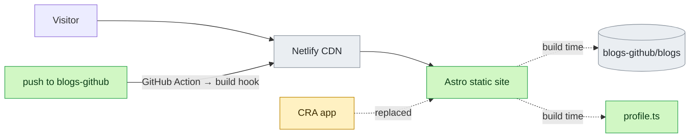
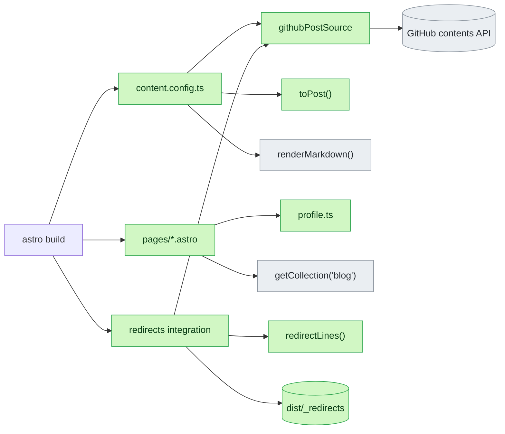

# Design: portfolio rebuild

Mockups (G2 approves these): [design canvas](https://claude.ai/artifact/Bnsu244NLuMajeRLL3Kxdg) — row "F · The Desk": Home, CV, Projects, Blog post.

## Context


## Approaches (blog source)
| | Option | Gain | Cost |
|---|---|---|---|
| ✅ | Build-time fetch from GitHub API, rebuild on push via build hook | Posts stay in blogs-github; static, fast, SEO | One Action + one Netlify secret |
| | Git submodule | No API call | Manual bump per post |
| | Runtime fetch in browser (today) | No rebuild | Slow, no SEO, API rate limits |

## Detail
### Pages
| Route | Source | Mockup |
|---|---|---|
| `/` | profile.ts + 3 latest posts | F · The Desk |
| `/cv` | profile.ts; print CSS → A4 | F · CV |
| `/projects` | profile.ts (work, OSS) | F · Projects |
| `/blog`, `/blog/<slug>` | blogs-github/blogs | F · Blog post |
| `/404` | static | — |

### Slug and redirect rule
```tree
Visitor opens /blog/<id>?
  yes -> Is id a known slug? | from file name
    yes -> Serve post page
    no -> Is id a current blob sha of a post? | old CRA URLs
      yes -> 301 to /blog/<slug> | redirect file
      no -> 404 page with link to /blog | post edited since [risk]
  no -> Other route
```
Slug: title part of `Title.dd_mm_yyyy.tag.md`, Vietnamese marks removed, lower case, `_` → `-`.

### Errors
| Error | Where | Visitor sees |
|---|---|---|
| GitHub API fails at build | content loader | nothing: build fails, old deploy stays (R6) |
| Bad file name | slug parser | build fails, names the file |
| Unknown path | Netlify | `/404` (R7) |

### Verify
Astro build + unit tests on slug/redirect parser; Playwright screenshots desktop + phone; Lighthouse ≥ 95; print `/cv` ≤ 2 A4.

## Decisions
| Door | Decision | Why |
|---|---|---|
| two-way | Astro replaces CRA in the same repo, on `feat/portfolio-rebuild` | Old app stays in git; Netlify rolls back |
| two-way | Astro pinned 7.3.8 (7.4 needs Node ≥ 22.23.4) | Local Node 22.23.2 |
| two-way | Netlify build command `npm run build`, publish `dist` | One setting |
| ⚠ one-way | Post URLs become `/blog/<slug>` | Shared links live forever; old sha links redirect |
| two-way | "Download PDF" = print `/cv` | The CV PDF holds a phone number |
| two-way | Visual world F · The Desk; one font: JetBrains Mono (has Vietnamese) | User: coding font |
| two-way | Nav: projects · blog · cv, lowercase; brand `nguyen.duy / bean` | Mono polish |
| two-way | Projects page: at work (14) → open source (4); no side projects | User |
| two-way | VelocityLabs on Projects only, not on CV | User |
| two-way | CV: two columns, grouped by product, sidebar with skills, OSS, education | User: more detail |

## Program design

### Types
```ts
// src/data/types.ts
export type Job = {
  org: string; role: string; when: string;         // display text, e.g. "Aug 2023 – now"
  context: string;                                 // team, product, contract type
  groups: { name: string; points: string[] }[];
  stack: string[];
};
export type WorkProject = { when: string; name: string; org: string; what: string; stack: string[] };
export type OssContribution = { repo: string; url: string; lang: string; prs: number; what: string };
export type LogLine = { when: string; level: 'INFO' | 'OK'; msg: string };
export type Profile = {
  name: string; nickname: string; headline: string; intro: string; summary: string;
  location: string; email: string; github: string;
  log: LogLine[];                                  // home laptop screen
  jobs: Job[];                                     // CV; VelocityLabs excluded
  earlier: Job;                                    // Online Edu + Rikkeisoft
  skills: { area: string; items: string }[];
  education: { school: string; degree: string; when: string };
  awards: { title: string; org: string; year: number }[];
  work: WorkProject[];                             // Projects; VelocityLabs included
  oss: OssContribution[];
};

// src/lib/posts.ts
export type PostFile = { name: string; sha: string; markdown: string };   // from the source
export type PostName = { titlePart: string; date: Date; tag: string };   // parsed file name
export type Post = {
  slug: string; file: string; title: string; date: Date; tag: string;
  lang: 'vi' | 'en'; sha: string; body: string;                         // body: markdown without H1
  readingMinutes: number;
};
export class PostNameError extends Error { constructor(readonly file: string) { super(`bad post file name: ${file}`); } }
export class SourceError extends Error {}
```

### Signatures
```ts
// src/lib/posts.ts — pure, unit tested
export function parsePostName(file: string): PostName;          // throws PostNameError
export function toSlug(titlePart: string): string;              // "Write_file_trong_Go" → "write-file-trong-go"
export function detectLang(markdown: string): 'vi' | 'en';      // Vietnamese marks → 'vi'
export function toPost(file: PostFile): Post;                   // throws PostNameError
export function assertUniqueSlugs(posts: Post[]): void;         // throws Error naming both files
export function redirectLines(posts: Post[]): string[];         // "/blog/<sha> /blog/<slug> 301"
export function loadPosts(source: PostSource): Promise<Post[]>; // list → toPost → unique; shared by loader and redirects

// src/lib/github.ts — adapter
export function githubPostSource(opts: { owner: string; repo: string; dir: string; token?: string }): PostSource;

// src/content.config.ts — wiring
export const collections: { blog: Collection };                 // loader: githubPostSource → toPost → renderMarkdown

// src/integrations/redirects.ts
export function redirects(opts: { source: PostSource; static: string[] }): AstroIntegration; // astro:build:done → dist/_redirects
```

### Ports
```ts
export interface PostSource { list(): Promise<PostFile[]> }     // throws SourceError
```

### File layout
```
astro.config.mjs            site URL, integrations
netlify.toml                build: npm run build → dist; Node 22
src/data/types.ts           profile types
src/data/profile.ts         every fact on the site
src/lib/posts.ts            name parse, slug, lang, redirects (pure)
src/lib/posts.test.ts       vitest
src/lib/github.ts           PostSource over GitHub contents API
src/lib/blog-source.ts      repo settings, shared by loader and redirects
src/content.config.ts       blog collection
src/integrations/redirects.ts  writes dist/_redirects
src/styles/global.css       tokens, JetBrains Mono, print rules
src/layouts/Base.astro      head, header, footer, design contract comment
src/components/Laptop.astro    home laptop + log
src/components/JobEntry.astro  one CV job
src/components/WorkRow.astro   one Projects row
src/pages/index.astro  cv.astro  projects.astro  404.astro
src/pages/blog/index.astro  blog/[slug].astro
public/favicon.svg
(old CRA files removed: src/*, public/*, stories/, .storybook/, yarn.lock)
```

### Call graph


### Error flow
| Error | Raised in | Handled in | Caller sees |
|---|---|---|---|
| `SourceError` (HTTP ≠ 200, rate limit) | github.ts | not caught | build exits ≠ 0; live site unchanged (R6) |
| `PostNameError` | posts.ts | not caught | build fails, names the file |
| duplicate slug | posts.ts | not caught | build fails, names both files |
| unknown path | Netlify | `404.astro` | 404 page (R7) |
