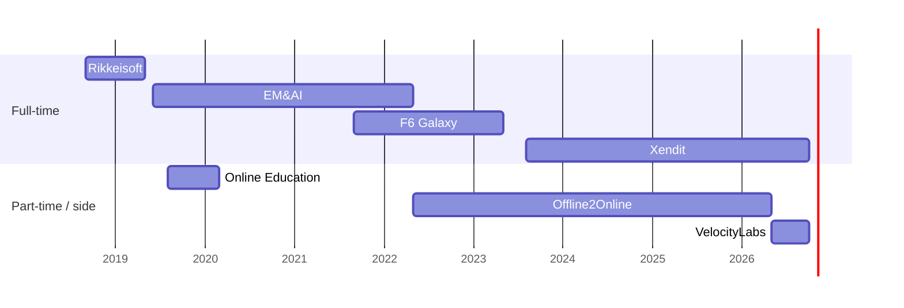

# Profile facts (merged)

Sources: **N** = CV 2026 (`Nguyen_Duy_CV_Fullstack.pdf`), **O** = CV 2023 (`Nguyen-Duy-Backend-Developer.pdf`), **X** = Xendit notes (`~/di/notes/xendit/weekly`, demos, Q1-2024 self-review). Only these facts go on the site.

Sources added: **G** = git history in `~/di` (dates, commit share), **U** = user answers 2026-10-29.

## Xendit — Software Engineer, Backend & Payments · Aug 2023 – now
Regional Expansion — Experiments team.

| Theme | What I built | Src |
|---|---|---|
| Offline Payments (EDC) | Owned backend from scratch: merchants take card + QR payments on Xendit terminals, tracked with online payments. | N, X |
| | Turned an Indonesia-only flow into reusable APIs, data models, workflows → Malaysia, Vietnam. Thailand in progress. | N, X |
| | 1+ year live, zero critical payment incidents. | N |
| | Phase 2: POS integration and payment sessions. Middleware between terminal provider and Xendit. | X |
| | Ops tool in Go: reconciles bank merchant reports against FTP terminal reports. | X |
| NAPAS card acquiring (VN) | Built connector, processor, payment-result handling, and payment card encryption. | X |
| CITAD disbursement (VN) | Transfers above 500M VND and to banks outside NAPAS. Payouts API + Dashboard single and batch. Merchants change no code. | X |
| | CITAD accounts in VN auto-withdrawal. New VN disbursement channels. | X |
| Checkout (VN) | Added VN virtual accounts and all VN eWallets to Checkout. Fixed ShopeePay multi-country routing with the channel team. | X |
| VN eWallets | Pending-redirect URL for unclear states, test "magic amount", eWallet refunds. | X |
| Bank VA | New connector for Cake VA. `payment_detail` in VA events → unblocked a merchant integration. | X |
| Nova loyalty app | Xendit internal loyalty app: recurring schedules (rrule), role-based access, localization, Postgres search, background jobs with retries. | X, U |
| Platform | Regional webhook config for batch disbursement. Instant activation for foreign merchants. | X |
| Customer support | XenPlatform, subscriptions, card integrations for merchants. | X |

Stack: Go, Node.js, React.js, PostgreSQL, Redis, AWS SQS, Kubernetes, Buddy CI/CD (N).

## VelocityLabs · 2026 (Projects page only, not on CV — user)
| Product | What | Src |
|---|---|---|
| MyCollectibles | Lending platform: collectors pledge TCG cards (Pokémon first) as loan collateral. Go gRPC + REST, PostgreSQL, Redis/Asynq. User, admin, partner APIs; price updates, shipping tracking, interest accrual; agent loan settings, bank withdrawals, catalog analytics, revolving downline. ~690 commits. | G, U |
| Perp CEX | Exchange backend: auth/IAM, wallet custody (deposits, reviewed withdrawals, KYC-tier limits), treasury sweep/refill, double-entry ledger, solvency invariant checks. ~260 commits. | G, U |

Role title and part-time status: assumed, not confirmed.

## Offline2Online — Backend Developer (part-time) · May 2022 – May 2026
Personalisation Hub, retail in-store platform for a major Australian telco. Team of 8 (O).

| What | Src |
|---|---|
| Core campaign management, orchestration, delivery to in-store displays: 500+ campaigns, 200+ stores. | N |
| Store queueing and appointments: ~100 daily walk-ins, ~30% shorter waits. | N, O |
| AI image and video generation for ads: asset time days → hours (~70%). | N |
| PH installer for AWS Marketplace: CloudFormation + Terraform provision EKS, RDS, S3; web UI; hibernate/wake cost controls; Marketplace metering (2024–26). | G |
| License server for PH installs (2022–24). | G |
| Code review, bug fixing, team support. | O |

Stack: Go, Echo, PostgreSQL, Redis, Dialogflow, ELK, Docker, AWS.

## F6 Galaxy — Backend Developer · Sep 2021 – May 2023
Pokerage: real-time multiplayer poker with matchmaking and tournaments. Team of 10 (O). Part-time, then full-time (N).

| What | Src |
|---|---|
| Designed the system and code structure from day one. | N, O |
| Core game logic: flow, rules, state, matchmaking, real-time play. | N, O |
| Redesigned socket state sync → no more clients stuck in invalid game states. | N |
| Performance tuning, tests, code review. | O |

Stack: Go, gRPC, PostgreSQL, Redis, MongoDB, Kafka, Docker, Kubernetes, Google Cloud.

## EM&AI — Full-stack Developer · Jun 2019 – May 2022
VNLP: chatbot and voice-bot platform. Team of 10 (O). **Best Employee of the Year 2020.**

| What | Src |
|---|---|
| Designed core backend from scratch: context management, training data, deployment. | N, O |
| Several thousand calls per day, Redis caching. | N |
| Observability: ELK, Prometheus, Grafana, Jaeger. | N, O |
| Voice bot on Asterisk PBX. | N, O |

Stack: Node.js, Express, MongoDB, Redis, Socket.io, Angular, React.js, Docker, NGINX, Kubernetes, AWS, GCP.

## Online Education System — Full-stack Developer · Aug 2019 – Mar 2020
Udemy-style course platform for Vietnamese learners (U). Team of 5 (O). Business model, system design, video-processing APIs, React frontend, Node/Express backend.

## Rikkeisoft — Full-stack Developer · Sep 2018 – May 2019
Cinema ticketing on serverless: Node.js, PostgreSQL, DynamoDB, Lambda, Vue.js (N, O).

## Education
Danang University of Technology — B.Eng. Information Technology, 2015 – 2020.

## Skills
| Area | Tools |
|---|---|
| Languages | Go, JavaScript / TypeScript |
| Backend | Node.js, REST, gRPC, microservices, distributed systems |
| Frontend | React.js, Angular, Vue.js |
| Data & messaging | PostgreSQL, MySQL, MongoDB, Redis, Kafka, RabbitMQ, AWS SQS |
| Cloud & ops | AWS, Google Cloud, Kubernetes, Docker, NGINX, Linux |
| Observability | Prometheus, Grafana, ELK, Jaeger |
| Domain | Payments: cards, VA, eWallets, disbursement, EDC terminals |

## Side projects (not shown on site — user)
| Group | Projects | Public |
|---|---|---|
| Backend from scratch | credstorage, fileservice, simple-db, redis-clone, goleaderboard, goeventqueue, webhook-svc, booking-server | yes |
| Built for myself | aoe-engine (browser AoE1 engine, lockstep multiplayer), bean (AI learning assistant), quizgate, moew (meeting assistant), beanshare (WebRTC file sharing), atbridge (local live transcription), ccmobile, e4u | local only |
| Games | Love2D pong, breakout, flappy-bird, match-3 | yes |

## Open source (GitHub, merged PRs)
| Repo | Contribution | When |
|---|---|---|
| vnteamopen/config-template (Go) | Nested templates, custom patterns, faster pattern search, write back to input file (4 PRs) | 2022 |
| vnteamopen/config-env (Go) | Default values; feature sync with config-template (2 PRs) | 2022 |
| vnteamopen/dataservicex (Go) | Integration tests against real MySQL and Postgres | 2022–23 |
| ledongthuc/awssecretsmanagerui | JWT auth for the API, filter-by-name API + tests, safer POSTs for sensitive calls, docs (5 PRs) | 2021 |
| goravel/goravel | Feature request `BindQuery`; bug report on `mock.Log()` | 2023 |
| ruby-vietnam/hardcore-rule | Weekly algorithm solutions, season 4 | 2021 |

Skipped: umarrasydan/docs (looks work-related), didi-smile/base-source.

## Left out
- Phone number (privacy).
- Bean Lens (VelocityLabs, Ray-Ban Meta OCR): user asked to exclude.
- Card issuing / subscription flows (weeks 15–18): not clear what shipped.
- Interview feedback and manager reviews (private).
