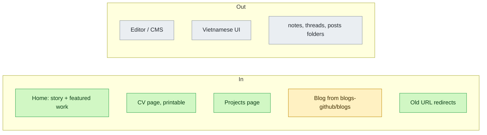
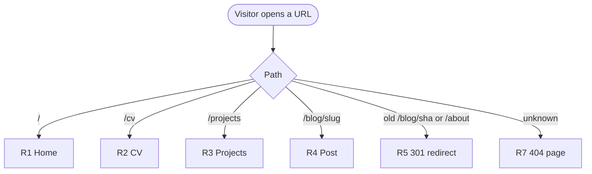

# Portfolio rebuild of duysmile.com

## Why (L0)
| | |
|---|---|
| Problem | duysmile.com shows only old notes. About still says "student". Seven years of work are invisible. |
| Outcome | One site shows who Duy is, what he built, and what he writes. Lighthouse ≥ 95 on all four scores. CV prints on ≤ 2 A4 pages. |
| Appetite | 2 days |
| No-gos | CMS or editor, comments, analytics, Vietnamese version, phone number or home address |
| Rabbit holes | Vietnamese file names → ASCII slugs. Relative images in markdown → raw GitHub URLs. |

## Scope

## What (L1)
Capabilities: [[specs/site]]

| ID | Δ | Requirement (EARS) | Scenarios |
|---|---|---|---|
| R1 | ADDED | When a visitor opens `/`, the site shall show intro, story, featured projects, recent posts. | happy: GIVEN profile data WHEN open `/` THEN 4 sections show |
| R2 | ADDED | When a visitor opens `/cv`, the site shall show experience, skills, education, awards, in print-ready layout. | happy: WHEN print THEN ≤ 2 A4 pages, no nav |
| R3 | ADDED | When a visitor opens `/projects`, the site shall show work projects, then open-source contributions. | happy: WHEN open THEN 2 sections, work first |
| R4 | MODIFIED | When the site builds, it shall render each markdown file in `blogs-github/blogs/` as a post page. | happy: GIVEN 2 files WHEN build THEN 2 posts, ASCII slugs |
| R5 | ADDED | When a visitor opens an old post or `/about` URL, the site shall redirect (301) to the new URL. | happy: `/blog/<blob sha>` → `/blog/<slug>` |
| R6 | ADDED | If the build cannot read `blogs-github`, then the build shall fail. | error: GIVEN GitHub down WHEN build THEN exit ≠ 0, live site unchanged |
| R7 | ADDED | If a visitor opens an unknown path, then the site shall show a 404 page with links home. | error: WHEN `/xyz` THEN 404 + nav |
| R8 | ADDED | The site shall take all profile facts from one data file. | happy: edit file → all pages change |

MODIFIED previous text:
- R4: old app fetched posts in the browser from the GitHub API at `/blog/:blobSha`.

## Assumptions
- Voice: warm and personal, first person, English.
- Employers named; end clients described generically.
- Netlify keeps hosting; only the build command changes.
- Profile facts come only from [[profile]]: CV 2026 + CV 2023 + Xendit notes.
- VelocityLabs is not on either CV, so the site leaves it out.

## Open questions
none
