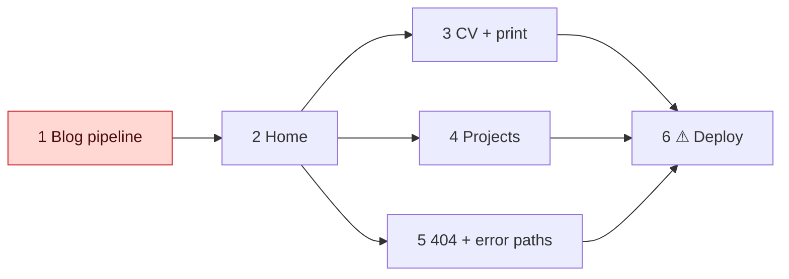

# Tasks: portfolio rebuild

## Slices

- [x] **1 Blog pipeline** (R4, R5, R6) — riskiest: proves Astro 7 loader + GitHub fetch.
  Astro replaces CRA. posts.ts + tests, github.ts, content.config.ts, redirects integration, Base layout, `/blog`, `/blog/[slug]`.
  Verify: `npm test` green; `npm run build`; `dist/blog/write-file-trong-go/index.html` exists, `lang="vi"`; `dist/_redirects` has 2 sha lines.
- [x] **2 Home** (R1, R8) — profile.ts, tokens, Laptop with log, 3 latest posts.
  Verify: build; desktop + phone screenshots match "F · The Desk".
- [x] **3 CV + print** (R2, R8) — JobEntry, sidebar, `$ download pdf` = `window.print()`.
  Verify: screenshots; Chromium print to PDF ≤ 2 A4 pages, no nav.
- [x] **4 Projects** (R3) — WorkRow list (14), OSS cards (4).
  Verify: screenshots match "F · Projects"; every OSS link resolves.
- [x] **5 404 + error paths** (R6, R7, R5) — `404.astro`, `/about → /cv`; bad file name and duplicate slug fail the build.
  Verify: unit tests for both errors; build with fake bad source exits ≠ 0; `/xyz` shows 404 in preview.
- [ ] **6 ⚠ Deploy** — steps, each with its own go-ahead:
  1. Add `netlify.toml` (build `npm run build`, publish `dist`, Node 22). Commit on `feat/portfolio-rebuild`, push, open PR. Two-way.
  2. You: in Netlify, confirm the site builds from this repo. Netlify then gives the PR a Deploy Preview.
  3. Verify on the preview: Lighthouse ≥ 95 ×4; old `/blog/<sha>` and `/about` return 301; `/xyz` returns 404.
  4. ⚠ Merge PR → production. Rollback: Netlify "Publish deploy" on the old deploy, or revert the merge.
  5. blogs-github: workflow calls a Netlify build hook on push. You create the hook and the repo secret.

## Learning candidates
- Astro 7 content layer: custom loaders, `renderMarkdown`.
- Netlify `_redirects` and build hooks.

## Follow-ups
none
