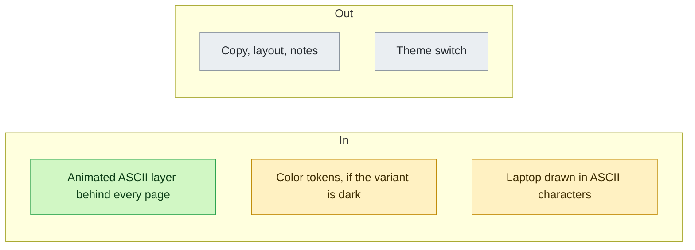
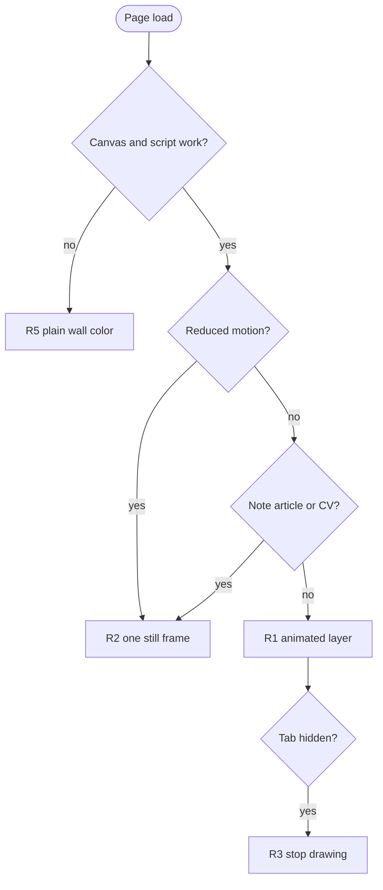

# ASCII background

## TL;DR

- One canvas draws characters on a grid behind the content.
- Text contrast stays at 4.5:1 or more. Lighthouse performance stays at 95 or more.
- The site changes from light to dark (variant B, night sky).

## Why (L0)
The owner wants the look of a reference video: a scene made of characters on a night sky.

| | |
|---|---|
| Problem | The wall is a flat grey. The owner wants the ASCII effect from instagram.com/p/Dfpt7bIxw2e. |
| Outcome | Each page shows the ASCII layer. Contrast ≥ 4.5:1. Lighthouse performance ≥ 95. |
| Appetite | Half a day |
| No-gos | Code panel from the video, sound, theme switch, WebGL, new dependencies |
| Rabbit holes | Glyph drift → ASCII characters only, measured cell width. Battery → low frame rate, stop when hidden. |

## What (L1)
One script draws the layer; the page works the same without it. Mockup: [mockups/ascii-bg.html](mockups/ascii-bg.html).



| ID | Δ | Requirement (EARS) | Scenarios |
|---|---|---|---|
| R1 | ADDED | While a page is visible, the site shall draw an animated ASCII layer behind the content. | happy: GIVEN home WHEN it loads THEN characters move behind the content |
| R2 | ADDED | While the user prefers reduced motion, or the page is a note article or the CV, the site shall draw one still frame. | edge: GIVEN reduced motion WHEN home loads THEN the layer does not move |
| R3 | ADDED | While the tab is hidden, the site shall stop drawing. | edge: GIVEN home WHEN the tab hides THEN no frame is drawn |
| R4 | ADDED | When the user prints a page, the site shall hide the layer. | happy: GIVEN CV WHEN printed THEN no layer, 2 pages or fewer |
| R6 | MODIFIED | The home page shall show the career log on a MacBook built from characters, screen text included; below 640px, in an ASCII terminal frame. | happy: GIVEN home WHEN it loads THEN each log line reads on the screen |
| R7 | ADDED | The site shall give screen readers the career log as text. | happy: GIVEN a screen reader WHEN it reaches the laptop THEN it reads each log line once |
| R5 | ADDED | If the canvas or the script is unavailable, then the site shall show the plain wall color. | error: GIVEN no JavaScript WHEN home loads THEN content reads on a flat wall |

MODIFIED previous text:
- R6: "laptop on a desk right, tailing a career log" (CSS-drawn laptop, `Laptop.astro`).

## Decisions
| Door | Decision | Why |
|---|---|---|
| two-way | Variant: **B night sky** (owner picked, 2026-11-15) | B has the feel of the video, works behind text on each page, and is not seasonal. |
| two-way | B and C change the color tokens to dark | The video is dark. Revert = restore the tokens in `global.css`. ⚠ Conflicts with PRODUCT.md "cool grey wall"; update it in the same change. |
| two-way | Still frame on note articles and the CV | Motion behind long text hurts reading. |
| two-way | Laptop is a front-view MacBook drawn on its own canvas as one image of characters: 244 x 121 cells, mixed characters in three tones from a fixed seed; each letter on the screen is 3 x 5 cells | The owner asked for the whole laptop, text included, built from characters like the reference. On load the lid opens from flat on the base (1.3 s), then the log tails in line by line; after that the cells shimmer. |
| two-way | Screen text is upper case; the INFO/OK column becomes color | A 3 x 5 cell letter reads only in capitals. 43 characters per line fit. |
| two-way | Without JavaScript, and below 640px, the log shows as a plain text terminal frame | The canvas needs a script; at 375px a cell is under 2px. |
| two-way | A visually hidden list repeats the log for screen readers; the `<pre>` is `aria-hidden` | Frame characters are noise when read aloud. |
| two-way | Canvas 2D, one `fillText` per row and color, 10–18 fps | No dependency. About 200 draw calls per frame. |

```tree
Must the site stay light?
  yes -> A quiet field | 2W · far from the video [rejected]
  no -> Must the scene from the video itself show?
    no -> B night sky | 2W · all pages, all year [chosen]
    yes -> C letter tree | 2W · seasonal, wide screens only [rejected]
```

## Assumptions
- Layer runs on all pages, from `Base.astro`.
- No code panel and no stats line.

## Open questions
none
