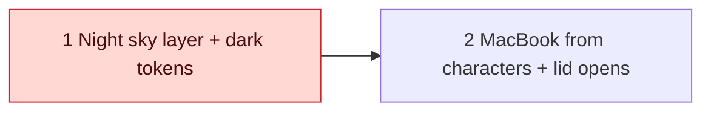
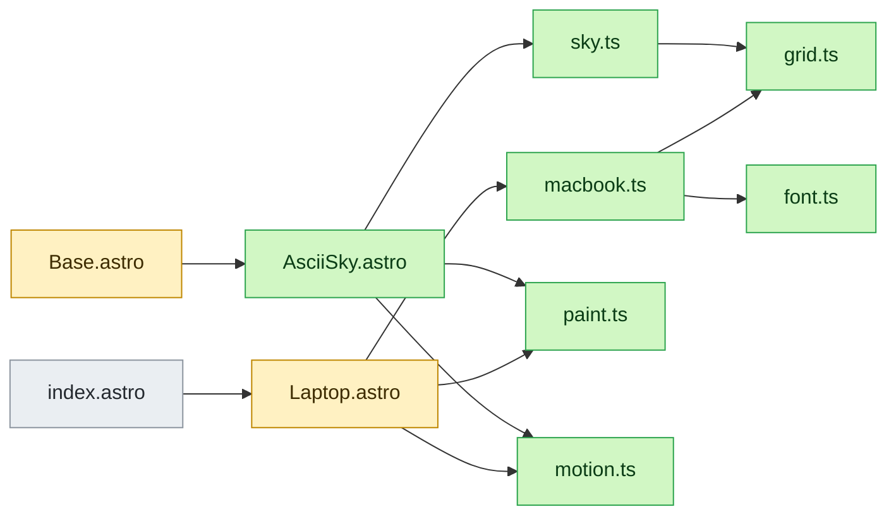

# Tasks: ASCII background

## TL;DR

- First: slice 1 changes each page (dark tokens). It proves contrast and print before the laptop work.
- ⚠ none. No migration, no deploy in this change.

## Program design
Pure grid logic lives in `src/lib/ascii`; two Astro components own the canvas and the timers.

- Idea: each drawing is a `Grid` of cells (tone + character). One painter draws a grid row by row, one `fillText` per row and tone.
- Reuse: `profile.log`, `LogLine`, the color tokens in `global.css`, the vitest setup.
- Rejected: WebGL, a `<pre>` with one span per cell (about 80 KB of HTML), a new dependency.



```
drawMode(env):
  no 2D canvas        → off      (R5: plain wall)
  reduced or still    → still    (R2: one frame)
  tab hidden          → paused   (R3)
  else                → animate  (R1)

frameAt(t):
  lidRows  = eased open fraction of the lid, min 2 rows
  litLines = lines shown after the lid is open, one per 0.16 s
  cursorOn = blinks after the last line

buildMacbook(log):
  a line longer than the screen, or more lines than fit → RangeError
  fill bezel, notch, base with mixed characters, three tones
  write each log line as 3x5-cell letters, upper case
```

```ts
type Grid = { cols: number; rows: number; tone: Int8Array; glyph: string[] }; // tone -1 = empty
type Sky = { grid: Grid; stars: Star[] };
type Macbook = Grid & { lid: number; line: Int8Array; cursor: number[]; lines: number };
type Frame = { lidRows: number; litLines: number; cursorOn: boolean };
type Mode = 'off' | 'still' | 'paused' | 'animate';

function makeSky(cols: number, rows: number, seed?: number): Sky
function skyFrame(sky: Sky, t: number): Grid
function drawMode(env: { canvas: boolean; reduced: boolean; still: boolean; hidden: boolean }): Mode
function unsupported(text: string): string[]
function buildMacbook(log: LogLine[], seed?: number): Macbook
function frameAt(t: number, lid: number, lines: number): Frame
function sourceRow(y: number, lid: number, lidRows: number): number
function rowText(grid: Grid, row: number, tone: number, shown?: (cell: number) => boolean): string
```

| Error | Raised in | Handled in | User sees |
|---|---|---|---|
| no 2D context, no script | `drawMode` → `off` | component script | flat wall; log in the text terminal frame |
| log line does not fit the screen | `buildMacbook` RangeError | not handled: the test fails, the build stops | nothing ships |
| character with no 3x5 glyph | `unsupported` in a test | not handled: the test fails | nothing ships |

## Slices

- [ ] 1. Night sky layer on each page, dark color tokens
  - Why first: it touches each page; contrast and print must hold before the laptop work.
  - Files: `src/lib/ascii/{rng,grid,sky,motion,paint}.ts`, `src/components/AsciiSky.astro`, `src/layouts/Base.astro`, `src/styles/global.css`, `src/components/Mug.astro`, `src/pages/cv.astro`, `src/pages/notes/[slug].astro`
  - Repos: single repo
  - Verify: `npx vitest run && npx astro check && npx astro build` → all pass; screenshots of home, notes, a note, CV, CV print
  - Covers: R1, R2, R3, R4, R5
  - Tests: T1, T2, T3, T4, T5, T6, T7, T15, T16, T18
- [ ] 2. MacBook built from characters; the lid opens, the log tails in
  - Files: `src/lib/ascii/{font,macbook}.ts`, `src/components/Laptop.astro`
  - Repos: single repo
  - Verify: `npx vitest run && npx astro check && npx astro build` → all pass; screenshots at t = 0.2, 0.6, 2.3, end; 375px
  - Covers: R6, R7
  - Tests: T8, T9, T10, T11, T12, T13, T14, T17

## Learning candidates
- Character-grid rendering on canvas: one `fillText` per row and tone — `src/lib/ascii/paint.ts`
- Seeded PRNG for repeatable generative art — `src/lib/ascii/rng.ts`
- 3x5 bitmap font — `src/lib/ascii/font.ts`

## Follow-ups
- Letter-tree scene (variant C) as a December extra.
